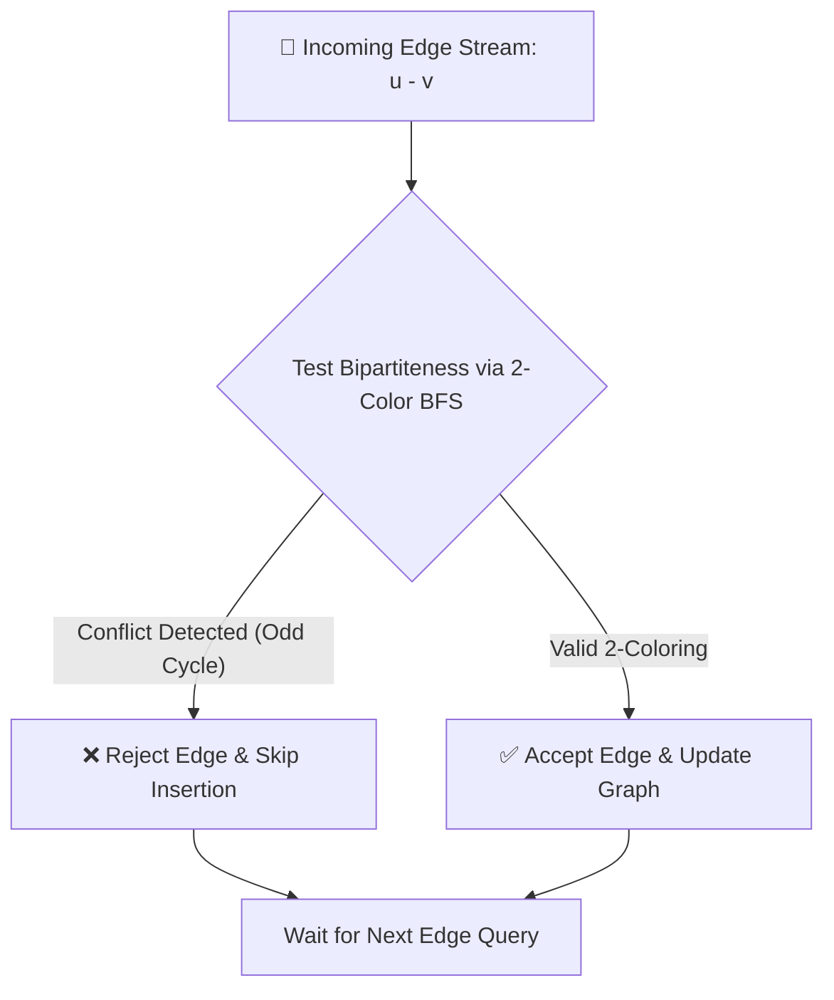
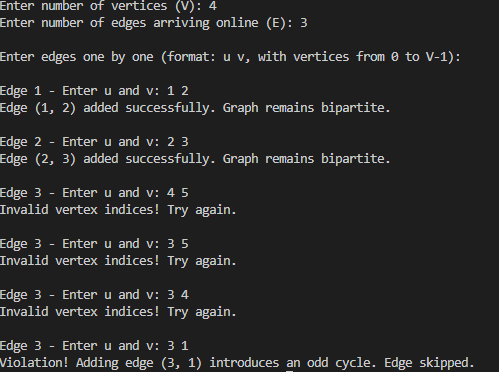
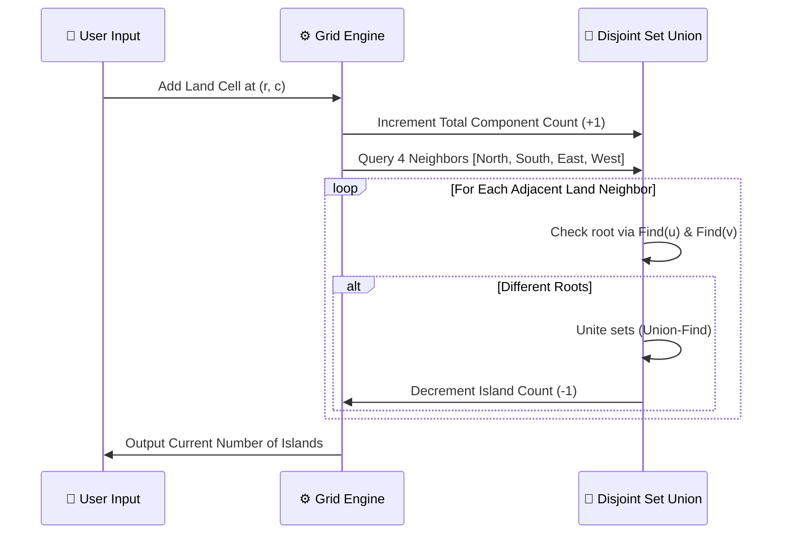
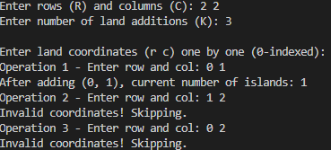
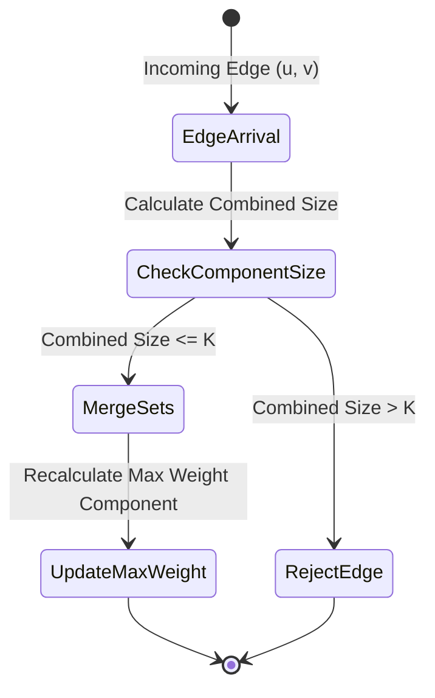
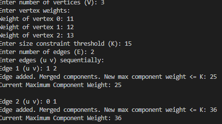
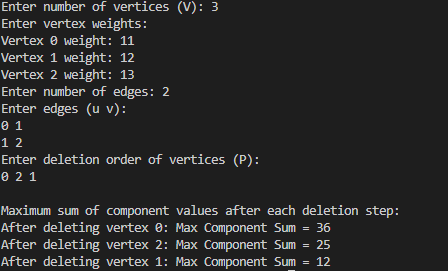
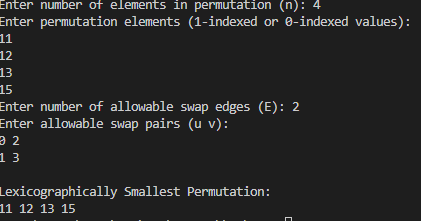

<div align="center">

# 🚀 DAA Lab 10: Advanced Graph Theory & Disjoint Set Union (DSU)

### **IIIT Bhubaneswar**
**Department of Computer Science & Engineering**


**Instructor:** Dr. Ajaya Kumar Dash  
**Course:** Design and Analysis of Algorithms (3rd Semester)

</div>

---

## 📌 Executive Overview

Lab 10 explores advanced topics in **Graph Theory**, **Dynamic Graph Stream Processing**, and **Disjoint Set Union (DSU / Union-Find)** algorithms utilizing **Path Compression** and **Union by Rank/Size**.

```
                           ┌─────────────────────────────────────────┐
                           │      DYNAMIC GRAPH ALGORITHMS          │
                           └────────────────────┬────────────────────┘
                                                │
         ┌───────────────────┬──────────────────┼───────────────────┬───────────────────┐
         ▼                   ▼                  ▼                   ▼                   ▼
┌───────────────────┐ ┌──────────────┐ ┌─────────────────┐ ┌──────────────────┐ ┌──────────────────┐
│ Online Bipartite  │ │ Dynamic Grid │ │ Size-Constrained│ │ Reverse Time     │ │ Lexicographical  │
│ Stream Testing    │ │ Islands II   │ │ Component Weight│ │ Offline Graph    │ │ Permutation Swaps│
└───────────────────┘ └──────────────┘ └─────────────────┘ └──────────────────┘ └──────────────────┘
```

---

## 🛠 Directory Layout & Outputs Structure

The repository structure matches the exact file organization below:

```
📂 Lab-10
├── 📂 Outputs
│   ├── 🖼️ Output1.png        # Execution output for Prog1.c
│   ├── 🖼️ Output2.png        # Execution output for Prog2.c
│   ├── 🖼️ Output3.png        # Execution output for Prog3.c
│   ├── 🖼️ Output4.png        # Execution output for Prog4.c
│   └── 🖼️ Output5.png        # Execution output for Prog5.c
├── 📜 Prog1.c                # Online Graph-Bipartiteness Testing
├── 📜 Prog2.c                # Dynamic Connected Components in a Grid (Islands II)
├── 📜 Prog3.c                # Maximum Weight Component with Size Constraints
├── 📜 Prog4.c                # Reverse Time-Step DSU Application
├── 📜 Prog5.c                # Lexicographically Smallest Permutation via Swaps
└── 📘 README.md              # Project Documentation & Complexity Analysis
```

---

## ⚡ Problem Set, Workflows & Interactive Visualizations

### 1. Online Graph-Bipartiteness Testing (`Prog1.c`)

#### 📖 Problem Description
Given an undirected graph with $V$ vertices, edges arrive online one by one. Maintain whether the graph remains bipartite (contains no odd-length cycles). If an incoming edge $(u, v)$ introduces an odd cycle, skip it; otherwise, insert it.

#### 🔄 Dynamic Workflow
<div align="center">
  
</div>



#### 🖼️ Output Verification
<div align="center">
  
</div>

#### 📊 Time Complexity Growth Curve

```
Complexity Scaling Comparison:
Time |
 O(E*(V+E)) |                      / (Standard BFS Iteration)
            |                     /
  O(E*α(V)) | . . . . . . . . . ./ _ _ _ _ _ (Optimized Parity DSU)
            +----------------------------------->
            0                   Incoming Edges (E)
```

* **Time Complexity:** $\mathcal{O}(E \cdot (V + E))$ using BFS per edge arrival / $\mathcal{O}(E \cdot \alpha(V))$ using 2-Coloring Parity DSU.
* **Space Complexity:** $\mathcal{O}(V^2)$ Adjacency Matrix or $\mathcal{O}(V + E)$ Adjacency List.

---

### 2. Dynamic Connected Components in a Grid (`Prog2.c`)

#### 📖 Problem Description
Given an $R \times C$ grid initially filled with water, land cells are added dynamically one by one at positions $(r_1, c_1), (r_2, c_2), \dots, (r_k, c_k)$. Output the current number of 4-directionally connected land components (islands) after each step.

#### 📐 Coordinate Flattening Technique
To map 2D spatial coordinates into 1D memory locations for fast DSU tracking:
$$\text{Flattened Index}(r, c) = r \times C + c$$

#### 🔄 Dynamic Union Process
<div align="center">
  
</div>



#### 🖼️ Output Verification
<div align="center">
  
</div>

* **Time Complexity:** $\mathcal{O}(K \cdot \alpha(R \cdot C))$ for $K$ dynamic operations, where $\alpha$ is the Inverse Ackermann function.
* **Space Complexity:** $\mathcal{O}(R \cdot C)$ flat set mapping.

---

### 3. Maximum Weight Component with Size Constraints (`Prog3.c`)

#### 📖 Problem Description
Given a graph where each vertex $v$ has weight $w_v$, weighted edges are added sequentially. Compute the maximum total vertex weight among all connected components whose size does not exceed a threshold $K$.

#### 📐 Component Merge Logic
$$\text{Size}(U \cup V) = \text{Size}(U) + \text{Size}(V)$$
$$\text{Weight}(U \cup V) = \text{Weight}(U) + \text{Weight}(V)$$
$$\text{Condition:} \quad \text{Size}(U \cup V) \le K$$



#### 🖼️ Output Verification
<div align="center">
  
</div>

#### 📊 Performance Timeline

```mermaid
gantt
    title Processing Overhead Strategy (Size Threshold K)
    dateFormat X
    axisFormat %s

    section Path Compression DSU
    Union-Find Operations O(E*alpha(V)) : active, 0, 18
    section Naive BFS/DFS Search
    Full Component Scan O(E*(V+E))     : crit, 0, 80
```



* **Time Complexity:** $\mathcal{O}(E \cdot \alpha(V))$
* **Space Complexity:** $\mathcal{O}(V)$ array structure for set tracking.

---

### 4. Reverse Time-Step DSU Application (`Prog4.c`)

#### 📖 Problem Description
Given a vertex-weighted undirected graph, vertices are sequentially deleted one by one in an order $P = [p_1, p_2, \dots, p_V]$. After each deletion, compute the maximum sum of vertex values among all remaining connected components.

#### 💡 Inverse Timeline Optimization Strategy
Dynamic vertex deletion breaks connected components, requiring expensive graph re-traversals ($\mathcal{O}(V \cdot (V + E))$). By **reversing the order of deletions**, vertex deletions become **incremental vertex additions**, lowering computation cost down to near-linear time ($\mathcal{O}((V + E) \cdot \alpha(V))$).

<div align="center">
  
</div>

```
Forward Timeline (Destructive):
[Full Graph] ──(Delete P[0])──> [Graph'] ──(Delete P[1])──> ... ──> [Empty Graph]

Reverse Timeline (Constructive):
[Empty Graph] <──(Add P[V-1])── [Graph''] <──(Add P[V-2])── ... <── [Full Graph]
```

#### 🖼️ Output Verification
<div align="center">
  
</div>

* **Time Complexity:** $\mathcal{O}((V + E) \cdot \alpha(V))$
* **Space Complexity:** $\mathcal{O}(V + E)$ Adjacency Matrix & DSU state vectors.

---

### 5. Lexicographically Smallest Permutation (`Prog5.c`)

#### 📖 Problem Description
Given a permutation $A$ of numbers $1 \dots n$ and a list of allowable pairwise swaps $(u, v)$ forming edges in an undirected graph, find the lexicographically smallest permutation achievable through any number of valid swaps.

#### 📐 Equivalence Class Sorting
Connected components formed by allowable swaps represent transitive equivalence classes. Any positions within the same component can be sorted in ascending order independently.


#### 🖼️ Output Verification
<div align="center">
  
</div>

* **Time Complexity:** $\mathcal{O}(E \cdot \alpha(n) + n \log n)$
* **Space Complexity:** $\mathcal{O}(n)$

---

## 📈 Consolidated Complexity Matrix

| Program | Algorithm Focus | Data Structure | Time Complexity | Space Complexity |
| :--- | :--- | :--- | :--- | :--- |
| **`Prog1.c`** | Online Bipartite Stream | BFS / Adjacency Matrix | $\mathcal{O}(E \cdot (V + E))$ | $\mathcal{O}(V^2)$ |
| **`Prog2.c`** | Dynamic Islands II | Flattened DSU Grid | $\mathcal{O}(K \cdot \alpha(R \cdot C))$ | $\mathcal{O}(R \cdot C)$ |
| **`Prog3.c`** | Size-Bounded Weight | DSU with Size/Weight | $\mathcal{O}(E \cdot \alpha(V))$ | $\mathcal{O}(V)$ |
| **`Prog4.c`** | Reverse Time Offline DSU | Offline Reverse Dynamic Set | $\mathcal{O}((V + E) \cdot \alpha(V))$ | $\mathcal{O}(V + E)$ |
| **`Prog5.c`** | Minimal Swap Sorting | Transitive Component DSU | $\mathcal{O}(E \cdot \alpha(n) + n \log n)$ | $\mathcal{O}(n)$ |

---

## 💻 Compilation & Execution Guide

Compile and run any program using GCC with standard C11 options:

```bash
# Clone the repository
git clone https://github.com/routsarthakkumar-byte/DAA-Lab.git
cd DAA-Lab/Lab-10

# Compile and execute Prog1
gcc -std=c11 -O2 Prog1.c -o Prog1
./Prog1

# Compile and execute Prog2
gcc -std=c11 -O2 Prog2.c -o Prog2
./Prog2

# Compile and execute Prog3
gcc -std=c11 -O2 Prog3.c -o Prog3
./Prog3

# Compile and execute Prog4
gcc -std=c11 -O2 Prog4.c -o Prog4
./Prog4

# Compile and execute Prog5
gcc -std=c11 -O2 Prog5.c -o Prog5
./Prog5
```

---

<div align="center">
  <strong>DAA Lab 10</strong> • <strong>IIIT Bhubaneswar</strong>
</div>