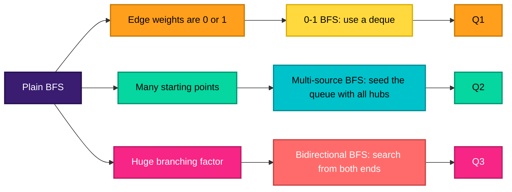
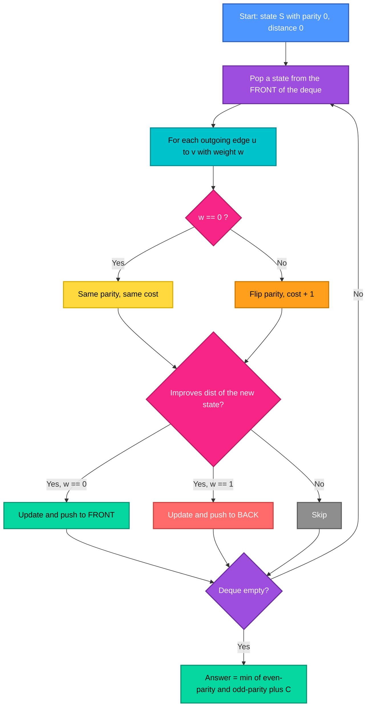
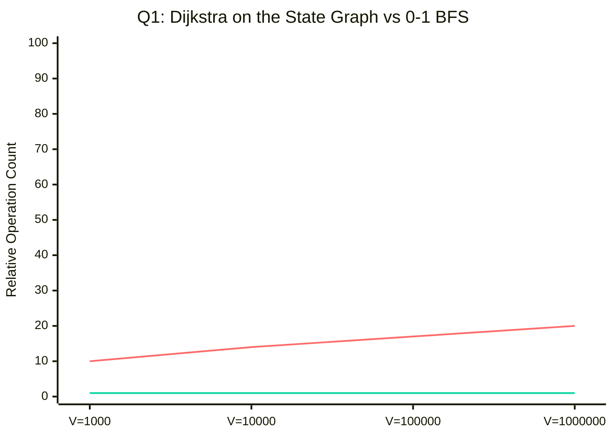
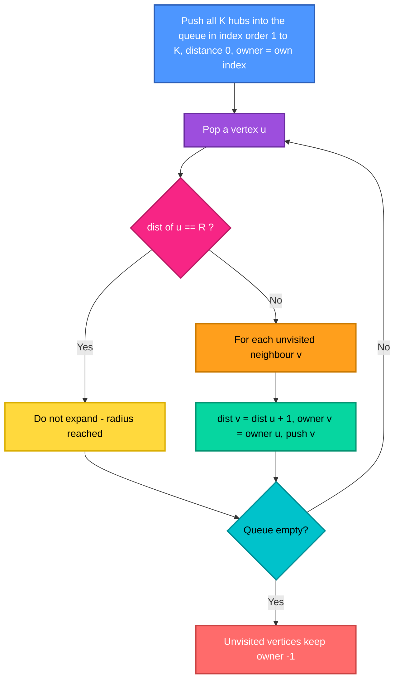
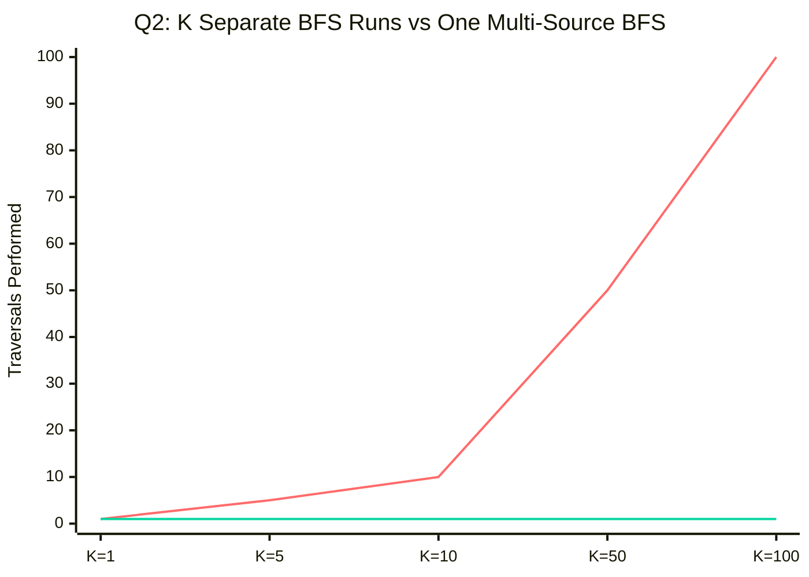
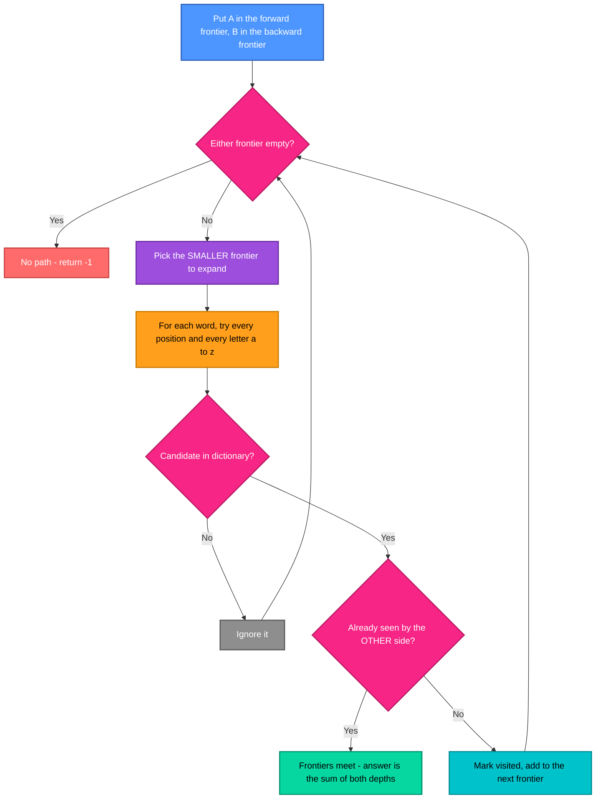
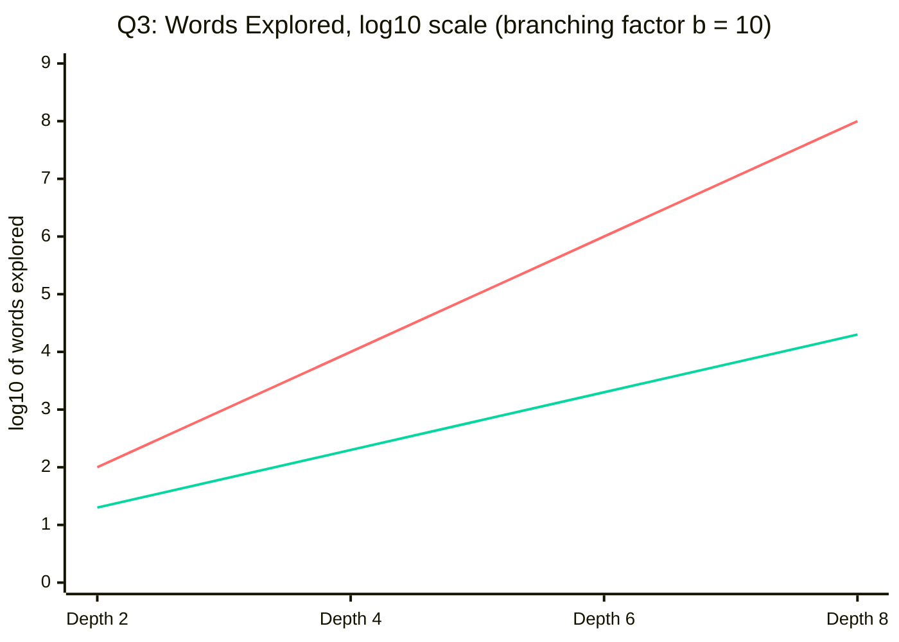
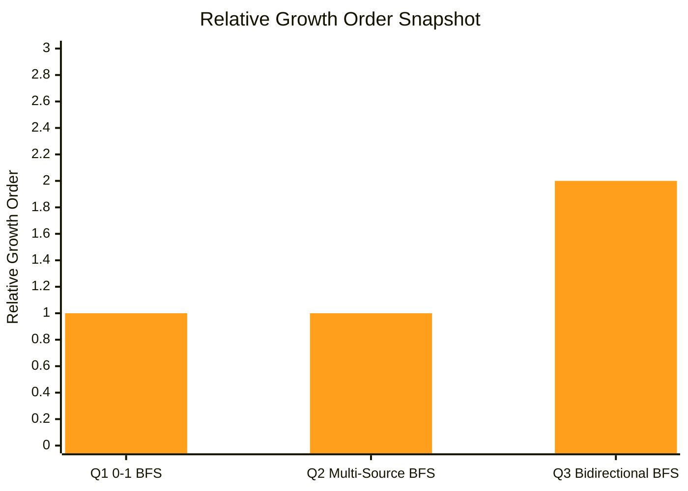

<div align="center">


</div>

---

## 📌 Lab Metadata

| Field | Detail |
|---|---|
| 🧪 **Lab No.** | 11 |
| 📘 **Course** | Design and Analysis of Algorithm (DAA) |
| 🎓 **Program** | BTech (CS-B and CE), 3rd Semester |
| 📅 **Date** | October 27, 2026 |
| 👨‍🏫 **Instructor** | Dr. Ajaya Kumar Dash |
| 🎯 **Theme** | Three advanced applications of Breadth-First Search — each one bends plain BFS to fit a harder problem |

---

## 🧠 Core Idea Behind This Lab

> Plain BFS finds shortest paths in **unweighted** graphs in `O(V + E)`. The three problems here each break one assumption — edges have weights, there are many sources, the search space is enormous — and the lesson is that you rarely need a heavier algorithm. You need to **change what BFS carries**: a smarter queue, a richer state, a second frontier.



---

## 📂 Problem Index

| # | Problem | BFS Variant | Complexity |
|---|---------|-------------|------------|
| 1 | [Parity-Constrained Shortest Path](#1--shortest-path-on-parity-constrained-graphs-via-0-1-bfs) | 0-1 BFS on a doubled state graph | `O(V + E)` |
| 2 | [Radius-Constrained Voronoi Partitioning](#2--multi-source-bfs-for-radius-constrained-voronoi-cell-partitioning) | Multi-source BFS | `O(V + E)` |
| 3 | [Word Transformation Sequence](#3--bidirectional-bfs-for-shortest-transformation-sequence) | Bidirectional BFS | `O(N · L² · 26)` worst case |

---

## 🧭 The BFS Family at a Glance

| Variant | Frontier structure | Handles | Time |
|---|---|---|---|
| Plain BFS | FIFO queue | Unweighted shortest paths | `O(V + E)` |
| **0-1 BFS** | Deque: weight-0 edges to the **front**, weight-1 edges to the **back** | Edge weights in `{0, 1}` | `O(V + E)` |
| Dijkstra | Priority queue | Arbitrary non-negative weights | `O((V + E) log V)` |
| **Multi-source BFS** | FIFO queue seeded with every source | Distance to the *nearest* of many sources | `O(V + E)` |
| **Bidirectional BFS** | Two FIFO frontiers that meet in the middle | One source, one target, large search space | same worst case, far fewer nodes in practice |

---

<div align="center">

</div>

## 1. ⚖️ Shortest Path on Parity-Constrained Graphs via 0-1 BFS

**Problem:** Directed graph, source `S`, penalty `C ≥ 0`, every edge weight is `0` or `1`. A path's cost is `W(P)` (sum of weights) **plus `C` if the number of weight-1 edges is odd**. Find the minimum cost to every vertex, or report it unreachable.

**Key observation:** Since every weight is `0` or `1`, the sum `W(P)` is *exactly* the count `k₁(P)` of weight-1 edges. So the cost of a path depends only on two numbers: how many 1-edges it uses, and whether that count is odd or even.

**Approach — double the state space:** Instead of one distance per vertex, keep **two**: `dist[v][0]` = fewest weight-1 edges to reach `v` using an **even** count, and `dist[v][1]` = fewest using an **odd** count. Then run 0-1 BFS over the states `(v, parity)`:
- A **weight-0** edge keeps the parity and costs nothing → push to the **front** of the deque.
- A **weight-1** edge flips the parity and costs 1 → push to the **back**.

The answer for each vertex is `min( dist[v][0],  dist[v][1] + C )`. Both infinite → unreachable.



**Worked example** (`C = 3`, source `0`): edges `0→1 (w=1)`, `1→2 (w=1)`, `0→2 (w=1)`, `2→3 (w=0)`.

| Vertex | `dist[v][0]` (even) | `dist[v][1]` (odd) | Cost = `min(even, odd + C)` |
|---|---|---|---|
| 0 | 0 | ∞ | **0** |
| 1 | ∞ | 1 | **4** (one 1-edge, odd, penalised) |
| 2 | 2 | 1 | **2** — the longer route `0→1→2` (two 1-edges, even) beats the direct edge (`1 + 3 = 4`) |
| 3 | 2 | 1 | **2** |

> 💡 Vertex 2 is the whole point of the problem: the *shorter-looking* path loses because of the penalty, so a single distance per vertex would give the wrong answer. The parity dimension is what makes it correct.



> Top line: `O((V+E) log V)` — the extra `log V` factor grows with the graph. Bottom line: `O(V+E)` — a deque replaces the priority queue. Illustrative relative scale.

| Metric | Complexity |
|---|---|
| States | `2V` — each vertex in two parities |
| Transitions | `2E` — each edge is relaxed from both parity states |
| **Time** | **`O(V + E)`** — each state is finalised once; deque operations are `O(1)` |
| Space | `O(V + E)` — adjacency list storing `(neighbour, weight)` plus `2V` distances |
| Dijkstra on the same state graph | `O((V + E) log V)` — correct but slower |

---

## 2. 🗺️ Multi-Source BFS for Radius-Constrained Voronoi Cell Partitioning

**Problem:** Unweighted undirected graph, `K` hub vertices, radius `R`. Give every vertex an **owner** — the closest hub within distance `R` (ties go to the smallest hub index), or `−1` if no hub is within `R` — together with that distance.

**Approach — start from all hubs at once:** Running one BFS per hub would cost `K` full traversals. Instead, put **every hub into the queue at distance 0**, in increasing index order, and run **one** BFS. Each vertex is claimed by whichever hub's wave reaches it first, and inherits that hub's index. Stop expanding once the distance reaches `R`; anything never reached keeps owner `−1`.

**Why the tie-breaking comes for free:** The queue is seeded in index order `1, 2, …, K`, and each BFS layer is discovered in the order of its parents. By induction, within every layer the owners appear in **non-decreasing** order — so when two hubs reach a vertex in the same layer, the **smaller index is always dequeued first** and wins. No explicit comparison is needed.



**Worked example:** path `1 – 2 – 3 – 4 – 5`, hubs `h₁ = 1`, `h₂ = 5`.

| Vertex | `R = 1` → owner, dist | `R = 2` → owner, dist |
|---|---|---|
| 1 | hub 1, 0 | hub 1, 0 |
| 2 | hub 1, 1 | hub 1, 1 |
| 3 | **−1** (both hubs are 2 away, beyond `R`) | **hub 1**, 2 — a tie with hub 2, broken toward the smaller index |
| 4 | hub 2, 1 | hub 2, 1 |
| 5 | hub 2, 0 | hub 2, 0 |



> Top line: one BFS per hub, `K` full traversals. Bottom line: a single multi-source traversal, no matter how many hubs.

| Approach | Time | Space |
|---|---|---|
| One BFS per hub, then compare `K` distances per vertex | `O(K · (V + E))` | `O(K · V)` |
| **Single multi-source BFS** | **`O(V + E + K)`**, i.e. `O(V + E)` since `K ≤ V` | `O(V + E)` |

---

<div align="center">

</div>

## 3. 🔤 Bidirectional BFS for Shortest Transformation Sequence

**Problem:** Dictionary `D` of `N` equal-length words (length `L`), a start word `A` and target `B`. One move changes exactly one character and must land on a word in `D`. Find the minimum number of mutations from `A` to `B`, or `−1`.

**Constraints:** `N ≤ 10⁵`, `L ≤ 10`, lowercase letters only.

**The word graph:** Words are vertices; two words are adjacent if they differ in exactly one position. The graph is never built explicitly — neighbours are **generated on demand** by trying every position and every replacement letter, keeping only candidates found in a **hash set** of the dictionary.

**Why bidirectional:** A one-directional BFS to depth `d` with branching factor `b` explores about `bᵈ` words. Searching from **both ends** and stopping when the frontiers touch explores only about `2 · b^(d/2)` — an exponential saving. Always **expand the smaller frontier** to keep the two sides balanced.





> Top line: one-directional BFS, `bᵈ` words. Bottom line: bidirectional, `2·b^(d/2)`. On a log scale the gap **doubles** with depth. The branching factor of 10 is an illustrative assumption, not a property of your dictionary.

| Metric | Complexity |
|---|---|
| Neighbours generated per word | `L` positions × `25` replacement letters ≈ `25L` candidates |
| Cost of one candidate | `O(L)` — build the string and hash it for the dictionary lookup |
| **Worst-case time** | **`O(N · 26 · L²)`** — each of up to `N` words is expanded once; bidirectional search keeps this bound but usually touches **far fewer** words |
| Space | `O(N · L)` — the dictionary hash set plus the two visited sets |
| With the given limits | `N · 26 · L² ≤ 10⁵ · 26 · 100 = 2.6 × 10⁸` elementary steps — a loose worst-case ceiling that a bidirectional search seldom approaches |

> ⚠️ Bidirectional BFS does **not** improve the *worst-case* big-O — if the only path happens to wind through most of the dictionary, both searches still cover it. Its power is the exponential cut in the *typical* number of explored nodes, which is why it is the standard choice for large word graphs.

---

## 📊 Complexity Landscape — All Three Problems



| Problem | BFS Variant | Time | Space |
|---|---|---|---|
| 1️⃣ Parity-constrained paths | 0-1 BFS on `2V` states | 🟢 `O(V + E)` | `O(V + E)` |
| 2️⃣ Voronoi partitioning | Multi-source BFS | 🟢 `O(V + E)` | `O(V + E)` |
| 3️⃣ Word transformation | Bidirectional BFS | 🟡 `O(N · 26 · L²)` | `O(N · L)` |

<sub>Q1 and Q2 are linear in the graph size. Q3's bound is polynomial in the dictionary and word length because the graph is implicit and neighbours are generated by brute-force substitution.</sub>

---

## 🛠️ Tech Stack

<div align="center">

</div>

<div align="center">


</div>

---

## ✅ Key Takeaways

- 🧱 **The queue is the algorithm.** Swapping a FIFO queue for a deque turns BFS into 0-1 BFS; seeding it with many sources turns it into multi-source BFS. The traversal logic barely changes — what you *put in the container* does.
- 🪞 **When a constraint is about history, add it to the state.** The parity penalty in Q1 depends on the whole path, so one distance per vertex is not enough; carrying `(vertex, parity)` makes the constraint local, and the graph simply doubles in size.
- ⚡ **Replacing a priority queue with a deque removes a `log` factor.** When weights are only `0` and `1`, Dijkstra's heap does unnecessary work — the front/back trick keeps the queue sorted by distance for free.
- 🎯 **Good seeding gives you tie-breaking for free.** In Q2, pushing hubs in index order means the smaller index is always dequeued first within a layer, so no comparison code is needed.
- 🌐 **Meeting in the middle is an exponential saving.** `b^(d/2) + b^(d/2)` versus `b^d` — the difference between searching a million words and searching a few thousand, even though the worst-case big-O is unchanged.

---

## 🗂️ Repository Structure

```
Lab-11/
│
├── 📁 Outputs/
│   ├── 🖼️ Output1.png   # Output — Parity-Constrained Shortest Path (0-1 BFS)
│   ├── 🖼️ Output2.png   # Output — Radius-Constrained Voronoi Partitioning
│   └── 🖼️ Output3.png   # Output — Word Transformation (Bidirectional BFS)
│
├── 🇨 Prog1.c           # Q1 · 0-1 BFS with parity states     → O(V + E)
├── 🇨 Prog2.c           # Q2 · Multi-Source BFS                → O(V + E)
├── 🇨 Prog3.c           # Q3 · Bidirectional BFS               → O(N · 26 · L²)
└── 📘 README.md         # You are here
```

| Program File | Problem Solved | Output |
|---|---|---|
| `Prog1.c` | Shortest Path on Parity-Constrained Graphs via 0-1 BFS | `Outputs/Output1.png` |
| `Prog2.c` | Multi-Source BFS for Radius-Constrained Voronoi Cell Partitioning | `Outputs/Output2.png` |
| `Prog3.c` | Bidirectional BFS for Shortest Transformation Sequence | `Outputs/Output3.png` |

### ⚡ Build & Run

```bash
# Compile any program (example: Prog1.c)
gcc Prog1.c -o Prog1

# Run it
./Prog1        # Linux / macOS
Prog1.exe      # Windows
```

> Repeat for `Prog2.c` and `Prog3.c`. File names are case-sensitive on Linux and macOS — they start with a capital `P`.

---

<div align="center">


**Made with 🧠 + ☕ for DAA Lab-11 · IIIT Bhubaneswar**

</div>